<picture>
  <source media="(prefers-color-scheme: dark)" srcset="./assets/banner-dark.svg">
  
</picture>

  
  

I run the AI practice at [Ipanova](https://www.ipanova.com), a French consulting firm based in Toulouse that works on SAP, data and custom software. My job is to take AI past the demo and into the tools people use at work, from the first scoping workshop down to the code.

I came to software late. For ten years I sold industrial and welding equipment, then ran the store, before retraining as a developer in 2020. Sales taught me to scope a need and put a price on it. I still start every project with the person who will use the tool.

## What I'm working on

- Building Ipanova's AI offer around four areas: strategy and governance, training, AI inside business processes and the ERP, and custom apps with agents.
- With our IT and security teams, getting the company ready for ISO/IEC 42001, the management standard for AI systems.
- Since July 2025, working with Airbus teams on how they use AI day to day, and building their workflows on the Google Gemini ecosystem.
- IANova, the internal program where our consultants share AI tools and methods. I host its monthly session.
- Spec-driven development, which I teach to developer teams on client projects: the spec comes first, then agents generate the code.

## Selected work

| Project | What it does | Built with |
| --- | --- | --- |
| JKD 31 analytics (private repo) | Collects my martial arts club's Facebook, Instagram, website and contact data every night. On Sundays, Hermes reads the numbers through an MCP server and writes the weekly analysis. | n8n, Python, Postgres, Next.js, MCP |
| Hermes (self-hosted) | My personal agent since August 2026, built on the open-source Hermes Agent from Nous Research. It writes a daily AI briefing that I read and answer on Signal, by text or voice. A second, isolated agent handles the web, and a few colleagues have restricted access. | Hermes Agent, Signal, VPS |
| [Job Market Intelligence](https://github.com/thobenayann/job-market-intelligence) | Turns France Travail and Adzuna job listings into a hiring dashboard for AI and SAP roles, in France and the US. | Python, Streamlit |
| [Ipanova design system](https://github.com/thobenayann/ipanova-design-system) | Ipanova's brand guidelines written for LLMs. Give an agent two Markdown files and a brief, and it produces on-brand slides for Canva, Google Slides or PowerPoint. | DESIGN.md, Markdown |

I also build and maintain websites for small businesses and associations, like [Hexo'print](https://hexoprint.vercel.app) (3D printing) and [JKD Self Defense 31](https://jkd-31.vercel.app), my martial arts club. Case studies are on [yanndevweb.com](https://www.yanndevweb.com/work).

## Path

| When | What |
| --- | --- |
| 2010 | Sales, then store manager, in industrial and welding equipment |
| Aug 2020 | Career switch: web development bootcamp at O'Clock |
| Jan 2021 | State certification as a web and mobile developer (two-year degree level) |
| Oct 2021 | Work-study at Ipanova as a fullstack developer |
| Jan 2023 | State certification as an application designer and developer (bachelor's level) |
| Oct 2023 | Tech lead at Ipanova |
| Oct 2024 | AI consultant and automation engineer |
| Jul 2025 | AI consultant for Airbus: AI adoption and Gemini workflows |
| Sep 2025 | AI lead, in charge of sharing AI knowledge across Ipanova |
| Jan 2026 | Head of AI at Ipanova |

## Stack

| Area | Tools |
| --- | --- |
| AI and agents | Claude Code, Codex, MCP, n8n, RAG, LLM APIs (Claude, Gemini, OpenAI) |
| Web | TypeScript, Next.js, React, Node.js, Tailwind CSS, shadcn/ui |
| Data and infra | PostgreSQL (Neon), Prisma, Docker, Vercel, a self-hosted VPS |
| Learning | Python, by writing Hermes' scripts with the standard library only |

If you organise a meetup or a conference on AI in the enterprise, I'm happy to give a talk. LinkedIn is the fastest way to reach me.
